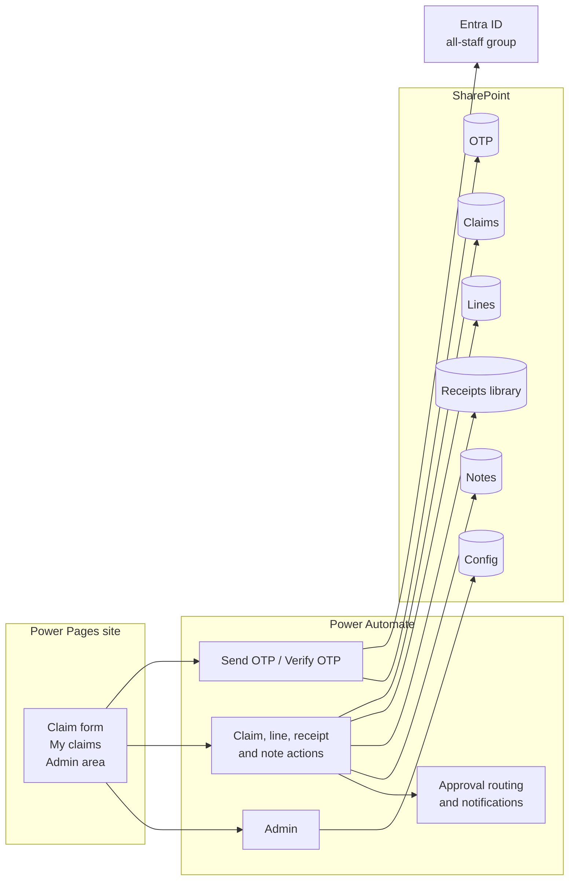
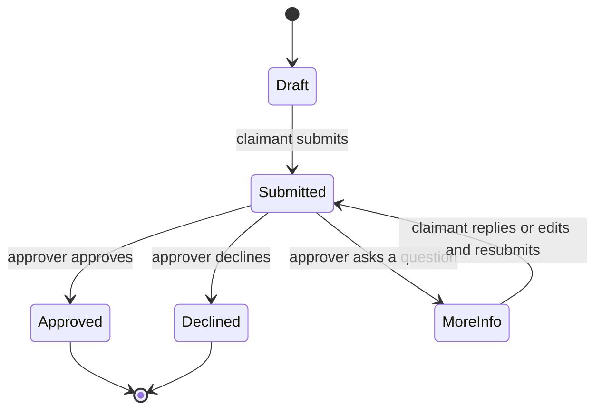
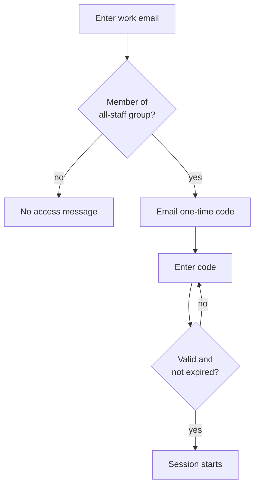
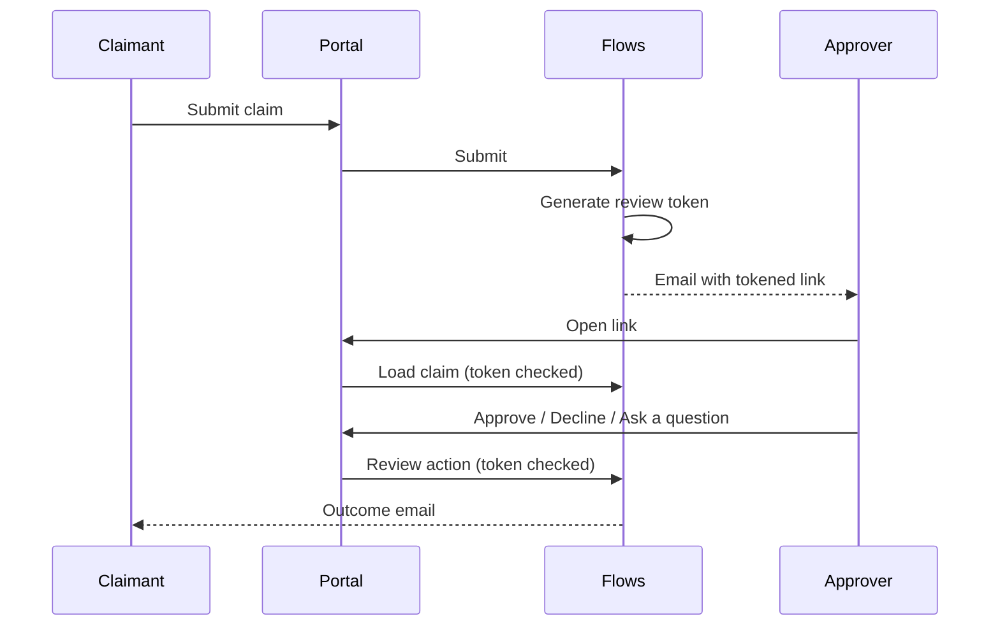

# Expense Claims Portal

An online replacement for a paper staff expense claim form. Staff sign in with an emailed one-time code, add any number of expense lines with receipts from a phone or PC, and submit. Approvers review the full claim from a secure link in their email, with no sign-in, and can approve, decline or ask a question.

> Case study. The production code, flows and data belong to my employer and are not published. This repository documents the design, architecture and decisions. All names and values shown are generic.

## Requirements

- Public page, no Entra sign-in, but only staff can use it. The staff check runs against the existing all-staff group, not a hand-kept whitelist.
- Multiple expenses of different types in one claim, each flagged billable or not, with GST.
- Travel and mileage with round trip, one way and multiple stops.
- Receipts from the phone camera, drag and drop, or scanned images and PDFs.
- Approval without a separate app: the approver opens the claim from email, can download it as a PDF at any time, and can ask the claimant for more information.
- An admin area that lists every claim and lets super admins edit settings.

## Architecture

Nine flows in total, eight of them HTTP-triggered from the page.

## Claim lifecycle

## Sign-in and staff check

## Approval by secure link

When a claim is submitted the flow stores a review token on the claim and emails the approver a link that carries it. The link opens that one claim in the portal with no sign-in, so approvers never need an account or an app.

## Decisions worth noting

- No OCR. Entry is manual with the receipt attached, which kept the build simple and accurate.
- No paid mapping keys. Staff open the route in a maps app and enter the kilometres; the provider hooks stay in the code but are switched off.
- PDF receipts are converted to images in the browser with PDF.js, so receipt pages appear inside the claim document without a paid PDF merge service.
- Lists were created by CSV import, so the flows reference the generated internal column names. Each one was checked against the import before wiring.
- Page fonts use the system font stack so the site looks native on any device.

## Documentation delivered

A user guide for staff and accounts with screenshots, and a technical note for whoever supports it next.

## Stack

Power Pages, Power Automate (nine flows), SharePoint Online lists and library, Entra ID groups, Outlook, PDF.js.
